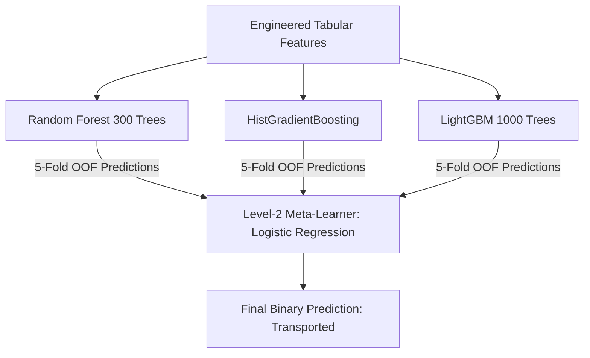

# 🚀 Spaceship Titanic: Multi-Model Stacking Ensemble & Feature Engineering

[](https://www.python.org/)
[](https://scikit-learn.org/)
[](https://lightgbm.readthedocs.io/)
[](https://www.kaggle.com/competitions/spaceship-titanic)
[](LICENSE)

An end-to-end machine learning pipeline for the **Kaggle Spaceship Titanic** competition, predicting whether passengers were transported to an alternate dimension during a spacetime anomaly. This project features domain-specific feature engineering, stratified out-of-fold (OOF) cross-validation, and a two-level stacking ensemble meta-classifier combining gradient boosting and tree ensembles.

---

## 📌 Problem Overview

The Spaceship Titanic was an interstellar passenger liner launched with ~13,000 passengers bound for three newly habitable exoplanets. While rounding Alpha Centauri, the ship collided with a spacetime anomaly, causing almost half the passengers to be transported.

* **Target Variable:** `Transported` (Binary: `True` / `False`)
* **Evaluation Metric:** Classification Accuracy & ROC-AUC
* **Key Challenge:** Disparate passenger records, multi-category cabin formats, zero-inflated luxury expenditure distributions, and missing values.

---

## 🛠️ Advanced Feature Engineering

The raw tabular data is transformed through domain-specific feature construction:

| Feature Category | Engineered Features | Description |
| :--- | :--- | :--- |
| **Cabin Decomposition** | `Deck`, `RoomNumber`, `Side`, `RoomEven` | Splits cabin strings (`B/0/P`) into deck level, room digit, port/starboard side, and cabin parity. |
| **Group Dynamics** | `GroupID`, `GroupSize`, `IsAlone` | Extracts traveling parties from `PassengerId` (`gggg_pp`) to identify family/companion sizes. |
| **Luxury Expenditure** | `TotalSpent`, `LogTotalSpent` | Aggregates and log1p-scales spending across `RoomService`, `FoodCourt`, `ShoppingMall`, `Spa`, and `VRDeck`. |
| **Demographics** | `Title`, `CryoSleep`, `VIP` | Extracts honorifics/titles from passenger names and normalizes boolean states. |
| **Imputation & Encoding** | `SimpleImputer`, `OrdinalEncoder` | Median numerical imputation with unified categorical ordinal mapping supporting unseen test values. |

---

## 🧠 Stacking Architecture

The solution uses a **two-level stacked ensemble architecture** to combine diverse decision boundaries:



1. **Level-1 Base Estimators:**
   * **Random Forest Classifier:** 300 decision trees capturing non-linear interactions without overfitting.
   * **HistGradientBoosting Classifier:** Fast binning-based boosting for numerical expenditure gradients.
   * **LightGBM Classifier:** Leaf-wise tree growth with 1,000 estimators for fine-grained splits.
2. **5-Fold Stratified K-Fold:**
   * Generates out-of-fold (OOF) prediction probability vectors on the training set to prevent data leakage.
   * Computes test set predictions averaged over the 5 cross-validation folds.
3. **Level-2 Meta-Learner:**
   * A regularized **Logistic Regression** classifier (L-BFGS solver) trained directly on the OOF probability matrix to learn optimal ensemble weightings.

---

## 📊 Pipeline & Validation Results

* **Validation Strategy:** Stratified 5-Fold Cross-Validation (`shuffle=True`, `seed=42`)
* **Feature Count:** 19 engineered features
* **Ensemble Gain:** Stacking meta-learner achieves higher validation accuracy and ROC-AUC compared to individual standalone models.

---

## 📁 Repository Structure

```
Titanic_Notebook/
├── README.md                  # Comprehensive project documentation
└── notebook079114e05d.ipynb   # Executable Jupyter notebook with complete pipeline
```

---

## 🚀 How to Run

### Option 1: Run Locally or on Kaggle
1. Clone the repository:
   ```bash
   git clone https://github.com/23051921/Titanic_Notebook.git
   cd Titanic_Notebook
   ```
2. Install dependencies:
   ```bash
   pip install numpy pandas scikit-learn lightgbm jupyter
   ```
3. Launch the notebook:
   ```bash
   jupyter notebook notebook079114e05d.ipynb
   ```

### Option 2: Upload to Kaggle
Upload `notebook079114e05d.ipynb` directly as a Kaggle notebook and attach the [Spaceship Titanic dataset](https://www.kaggle.com/competitions/spaceship-titanic).
